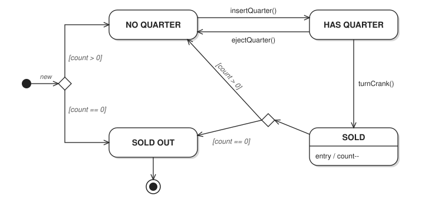

# Gumball machine: State pattern with Java enum states

This project implements the same gumball machine as an earlier TypeScript version (`gumball-new-state-objects`, where each state is a class and every transition creates a new state object), but in **Java**, with each state written as an **enum constant** instead of a separate class.



## Running it

```bash
javac -d out src/*.java && java -cp out Main
```

(This command is also a shortcut in `terminal.console`. You need Java 17 or later, and nothing else to install.)

## The files

| File | Role in the pattern |
|---|---|
| `src/GumballState.java` | The **states**: one enum, four constants, each with its own method bodies |
| `src/GumballMachine.java` | The **context**: remembers the current state and delegates every event to it |
| `src/Main.java` | Text menu for driving the machine by hand |

## How an enum can be a State object

A Java enum constant can have its **own class body**, which overrides methods declared in the enum:

```java
public enum GumballState {

    NO_QUARTER("NO QUARTER") {
        @Override
        public void insertQuarter(GumballMachine machine) {
            changeState(machine, HAS_QUARTER);
        }
    },
    ...;

    // defaults, used by any constant that does not override them
    public void insertQuarter(GumballMachine machine) { invalid("insert a quarter"); }
    ...
}
```

Behind the scenes, each constant is an anonymous **subclass** of `GumballState`, so calling `state.insertQuarter(this)` is ordinary polymorphism. There is **no `switch` on the state anywhere**. That's what makes this the State pattern, not just an enum used as a label.

One convenience comes for free: each constant only writes the events that are **valid** in that state. Every other event falls through to the default "invalid event" method, so you don't repeat it four times as you do with one class per state.

## Compared with creating new state objects

| | `gumball-new-state-objects` (TypeScript) | this project (Java enum) |
|---|---|---|
| Making a state change | `machine.setState(new SoldState(this.machine))` | `machine.setState(SOLD)` |
| How a state finds its machine | Stored in a **field**, set by the constructor | Passed as a **parameter** to every event method |
| Number of state objects | A new one on **every transition** | Exactly **one per state**, created by the JVM |
| Shared between machines? | No, each object is tied to one machine | Yes, every machine uses the same `NO_QUARTER` object |
| Checking the current state in tests | `toString()` or `instanceof` | `machine.getState() == GumballState.SOLD` |
| Invalid events | Written out in every state class | Written once as the default in the enum |
| Number of files | One per state + interface | One enum file |

## Why sharing state objects is safe here

Because states are shared, **a state must not keep any data about a particular machine**. If `HAS_QUARTER` had a field such as `private int attempts`, two machines would overwrite each other's value.

That's why:
- the only field in `GumballState` is `label`, which is `final` and the same for every machine
- the gumball **count** lives in the **context** (`GumballMachine`), and states read or change it through `machine.getCount()` / `machine.setCount()`

So two `GumballMachine` objects can use the very same `NO_QUARTER` / `HAS_QUARTER` objects without affecting each other.

## Note: TypeScript enums can't do this

A TypeScript `enum` is only a set of named numbers or strings. It **can't have methods**, so it can't be a State object. Using one in the context would force a `switch (this.state)` inside every event method, which is the conditional code the State pattern is meant to remove.

In TypeScript, the closest thing to this project is **one shared instance per state**, for example:

```ts
export const STATES = {
    noQuarter:  new NoQuarterState(),
    hasQuarter: new HasQuarterState(),
    ...
};
```

with the machine passed into each event method, as in this project.

## Entry action in SOLD

`SOLD` has no valid external events. All of its work happens in its **entry action**, which `GumballMachine.setState()` calls immediately after every state change:

1. take one gumball off the count
2. move to `NO_QUARTER` if gumballs are left, otherwise to `SOLD_OUT`

So turning the crank goes `HAS_QUARTER -> SOLD -> NO_QUARTER` (or `-> SOLD_OUT`) in a single call.

## Licence

MIT, see [LICENSE](LICENSE).
